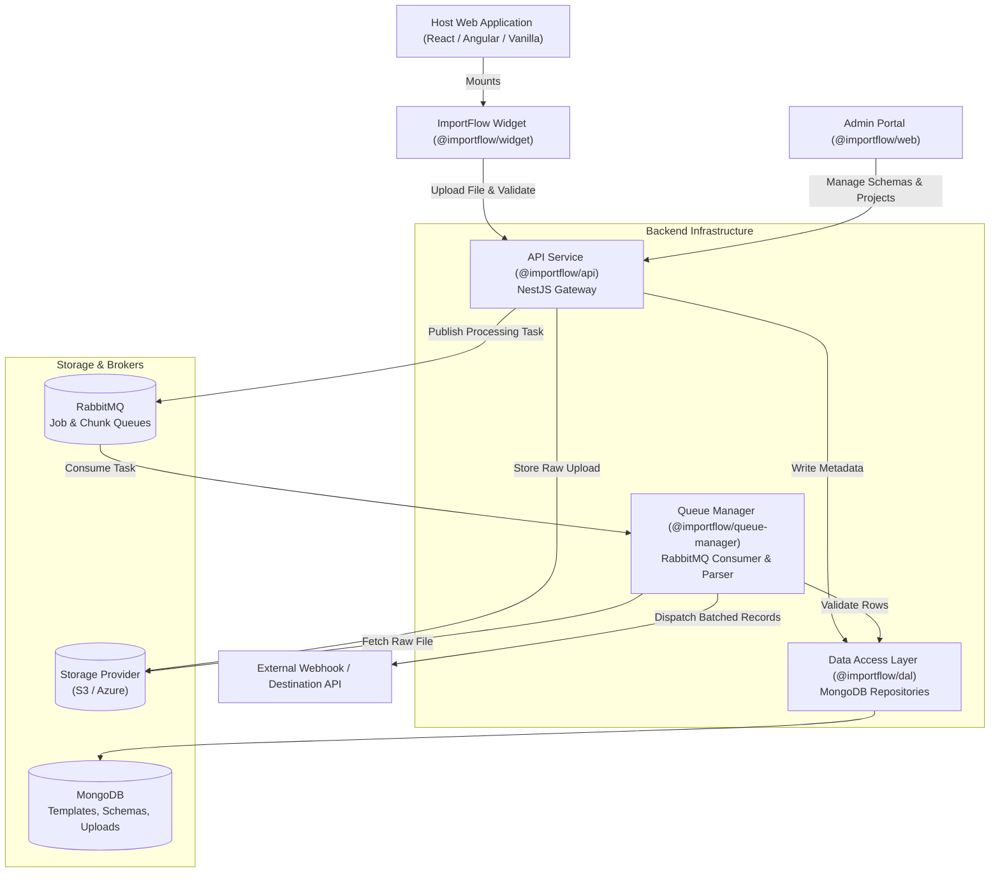

# importflow

A complete, self-hostable CSV and Excel data import SaaS platform that handles file parsing, relational column mapping, real-time validation, and webhook dispatching for external applications.

## What This Project Does

Ingesting user-submitted CSV and Excel spreadsheets into web applications is notoriously error-prone, requiring custom parsers, schema validation rules, column matching, and error correction flows. Building bespoke import interfaces for every product distracts development teams from core business logic.

**importflow** provides production-grade, embeddable data onboarding infrastructure. It delivers a turnkey spreadsheet import modal with intelligent header matching, cell-level validation, spreadsheet error-correction tables, and resilient distributed queue processing.

### Key Features
* **Embeddable Import Widget:** Drop-in spreadsheet import wizard for React, Angular, and vanilla JavaScript applications.
* **Intelligent Column Mapping:** Automatically matches spreadsheet columns to target data schema with fuzzy header recognition and validation constraints.
* **In-Browser Cell Correction:** Interactive spreadsheet grid (powered by Handsontable) allowing users to fix invalid cells in place before submitting data.
* **Distributed Queue Architecture:** Offloads heavy file parsing and row-by-row validation to dedicated RabbitMQ queue workers, preventing API thread exhaustion during high-volume imports.
* **Pluggable Validation Rules:** Configure required fields, data formats, regex patterns, uniqueness checks, and external REST lookups.
* **Webhook & Destination Dispatch:** Streams cleaned and validated records directly to target endpoints or database sinks with configurable batching and retries.
* **Administrative Management Portal:** Next.js dashboard for inspecting import history, editing schema/destination/validator/output settings, and managing team members and billing.

---

## How It Works

The platform operates as a modular monorepo combining client SDKs, an API gateway, asynchronous queue workers, and an administrative dashboard:



---

## Project Structure

```
importflow/
├── apps/
│   ├── api/                # NestJS core REST API (projects, templates, columns, uploads)
│   ├── queue-manager/      # Distributed RabbitMQ background worker for file processing
│   ├── web/                # Next.js administrative dashboard and template management UI
│   └── widget/             # Embeddable import UI wizard (React + Handsontable grid)
├── libs/
│   ├── dal/                # MongoDB Data Access Layer schemas, models, and repositories
│   ├── embed/              # Vanilla JavaScript iframe wrapper for loading the widget
│   ├── services/           # Storage, email, payment, bubble, naming, and RSS/XML services
│   └── shared/             # Shared TypeScript types, enums, DTOs, and constants
├── packages/
│   ├── angular/            # Angular wrapper component for the ImportFlow widget
│   ├── client/             # Headless TypeScript client for programmatic imports
│   └── react/              # React wrapper hook and component for the ImportFlow widget
├── lerna.json              # Lerna multi-package versioning configuration
├── nx.json                 # Nx monorepo pipeline and caching configuration
├── package.json            # Root workspace scripts and dependencies
├── pnpm-workspace.yaml     # pnpm workspace monorepo definition
└── tsconfig.base.json      # Base TypeScript compiler options and monorepo path aliases
```

---

## Getting Started

```bash
pnpm install
```

Copy the environment template and follow the run commands in the project scripts.
